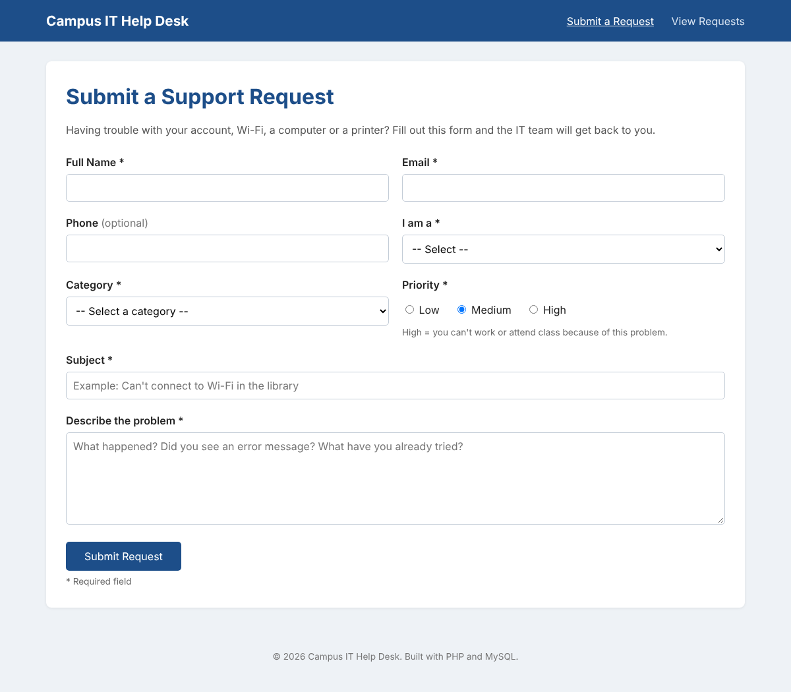
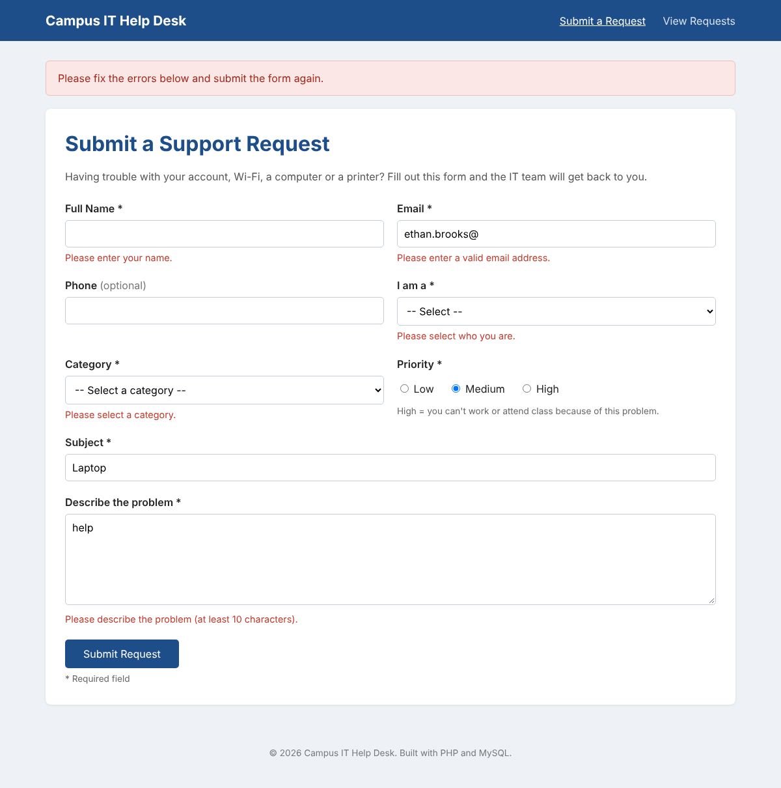
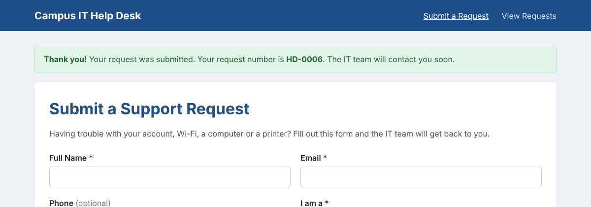
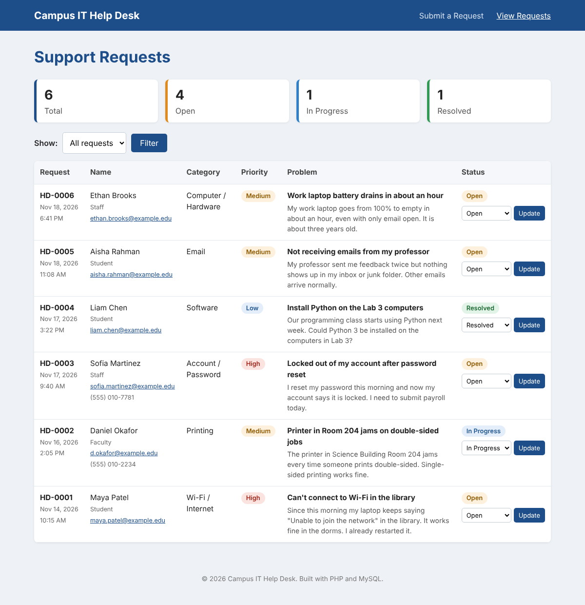

# Campus IT Help Desk

A PHP and MySQL web application where students, faculty and staff can submit IT support requests (Wi-Fi problems, password resets, printer issues and so on). Every request sent through the form is saved in a MySQL database, and the IT team can view all requests and update their status.

I used the form handling and database examples from the textbook as a starting point and turned them into a help desk that a school's IT department could use.



---

## Features

- Support request form with name, email, phone, user type, category, priority, subject and problem description
- Every submission is saved to a MySQL database using PDO prepared statements
- Server-side validation of every field, with an error message under each field that has a problem
- A "View Requests" page that lists all requests, newest first
- Filter the list by status (Open, In Progress, Resolved)
- Change the status of any request from the list
- Works on phones as well as computers

## Unique Features

These go beyond the basic "submit a form and save it" example:

1. **Request numbers.** After a request is saved, `$pdo->lastInsertId()` gets the new row's ID and the user sees a request number like **HD-0006** that they can refer to later.
2. **Help desk workflow.** Each request has a status (Open, In Progress or Resolved). The IT team can change it right from the list, so the app also *updates* data in the database, not only inserts it.
3. **Summary counts.** The View Requests page shows how many requests are Open, In Progress and Resolved, calculated with a `GROUP BY` query.
4. **Color-coded priority and status labels**, so urgent (High priority) problems stand out.
5. **Sticky form.** If there is an error, the form keeps everything the user typed, so they only need to fix the field with the problem.
6. **No duplicate submissions.** After saving, the page redirects (Post/Redirect/Get), so refreshing the page does not submit the same request twice.

## Screenshots

**Validation errors**: shown under each field, and the user's input is kept:



**Success message** with the request number:



**View Requests page** with summary counts, filter and status updates:



---

## Technologies Used

- PHP 8 (also works on PHP 7.4)
- MySQL / MariaDB
- PDO (PHP Data Objects) for the database connection
- HTML5 and CSS3
- XAMPP for running it locally

## Project Files

```
campus-helpdesk/
├── index.php          The support request form + the code that validates and saves it
├── requests.php       Lists all requests, filters by status, updates the status
├── db_connect.php     Connects to the MySQL database with PDO
├── database.sql       Creates the database and the support_requests table
├── includes/
│   ├── header.php     Page header and navigation (shared by every page)
│   └── footer.php     Page footer (shared by every page)
├── css/
│   └── style.css      Styles for the whole site
└── screenshots/       Images used in this README
```

---

## Setup Instructions (XAMPP)

1. **Install XAMPP** from [apachefriends.org](https://www.apachefriends.org). Open the XAMPP Control Panel and start **Apache** and **MySQL**.

2. **Download this project.** Click the green **Code** button on GitHub, choose **Download ZIP**, and unzip it.
   Rename the folder to `campus-helpdesk` (GitHub names it `campus-helpdesk-main`).

3. **Move the folder into `htdocs`:**
   - Windows: `C:\xampp\htdocs\campus-helpdesk`
   - Mac: `/Applications/XAMPP/htdocs/campus-helpdesk`

4. **Create the database:**
   - Go to [http://localhost/phpmyadmin](http://localhost/phpmyadmin)
   - Click the **Import** tab, choose the `database.sql` file from the project folder, and click **Import** (or **Go**)
   - This creates the `helpdesk_db` database and the `support_requests` table

5. **Check the database login** in `db_connect.php`:

   ```php
   $host     = 'localhost';
   $dbname   = 'helpdesk_db';
   $username = 'root';
   $password = '';
   ```

   These are XAMPP's default settings, so they work on a fresh install. If your MySQL user has a password, enter it here. (On MAMP the default password is `root`.)

6. **Open the site:** [http://localhost/campus-helpdesk/](http://localhost/campus-helpdesk/)

**If you see "Could not connect to the database":** make sure MySQL is running in XAMPP, that you imported `database.sql`, and that the username and password in `db_connect.php` are correct.

---

## How to Use It

**Submitting a request**

1. Click **Submit a Request** in the menu (this is the home page).
2. Fill in the form. Fields marked with * are required.
3. Click **Submit Request**.
4. If something is missing or invalid, a red message appears under that field. Fix it and submit again.
5. When the request is saved, a green message shows the request number (for example **HD-0006**).

**Viewing and managing requests**

1. Click **View Requests** in the menu.
2. The boxes at the top show the total number of requests and how many are Open, In Progress and Resolved.
3. Use the **Show** drop-down and click **Filter** to see only one status.
4. To change a request's status, pick the new status in the Status column and click **Update**.

---

## How the Form Works with the Database

### Step by step

1. The user fills out the form in `index.php` and clicks **Submit Request**. The form uses `method="post"` and sends the data back to `index.php`.
2. PHP reads each field from `$_POST` and uses `trim()` to remove extra spaces.
3. Every field is validated:
   - required fields cannot be empty
   - the email is checked with `filter_var($email, FILTER_VALIDATE_EMAIL)`
   - the phone number (optional) is checked with a regular expression
   - the "I am a", category and priority values must be one of the allowed options
   - the lengths are checked so they fit in the database columns
4. If there are errors, the form is shown again with an error message under each problem field and the values the user typed.
5. If everything is valid, the data is saved with a **prepared statement**:

   ```php
   $sql = "INSERT INTO support_requests
               (full_name, email, phone, user_type, category, priority, subject, description)
           VALUES
               (:full_name, :email, :phone, :user_type, :category, :priority, :subject, :description)";

   $stmt = $pdo->prepare($sql);
   $stmt->execute([
       ':full_name' => $fullName,
       ':email'     => $email,
       // ...and the rest of the fields
   ]);
   ```

6. `$pdo->lastInsertId()` returns the ID of the new row. PHP redirects to `index.php?success=ID`, which shows the success message with the request number.
7. `requests.php` reads the requests with `SELECT * FROM support_requests ORDER BY id DESC` and shows them in a table. When the IT team changes a status, it runs `UPDATE support_requests SET status = :status WHERE id = :id`.

### Database table: `support_requests`

| Column        | Type                                  | Where the data comes from                       |
|---------------|---------------------------------------|-------------------------------------------------|
| `id`          | INT, AUTO_INCREMENT, PRIMARY KEY      | Created by MySQL, used as the request number    |
| `full_name`   | VARCHAR(100)                          | "Full Name" text box                            |
| `email`       | VARCHAR(100)                          | "Email" text box                                |
| `phone`       | VARCHAR(20), can be NULL              | "Phone" text box (optional)                     |
| `user_type`   | VARCHAR(20)                           | "I am a" drop-down (Student, Faculty, Staff, Visitor) |
| `category`    | VARCHAR(50)                           | "Category" drop-down                            |
| `priority`    | VARCHAR(10)                           | "Priority" radio buttons (Low, Medium, High)    |
| `subject`     | VARCHAR(150)                          | "Subject" text box                              |
| `description` | TEXT                                  | "Describe the problem" text area                |
| `status`      | VARCHAR(20), default `'Open'`         | Starts as Open, changed on the View Requests page |
| `created_at`  | TIMESTAMP, default `CURRENT_TIMESTAMP` | Filled in automatically by MySQL               |

---

## Security

- **Prepared statements:** every query that uses user input goes through PDO prepared statements, so the data is never mixed into the SQL. This protects against **SQL injection**.
- **Escaping output:** everything shown on the page from the database goes through `htmlspecialchars()`, so HTML or JavaScript typed into the form is displayed as plain text instead of running. This protects against **cross-site scripting (XSS)**.
- **Server-side validation:** the browser checks the form too, but that can be bypassed, so PHP checks every field again. Drop-down and radio values must match the allowed lists, even if someone edits the HTML.
- **Length limits** in the form and in PHP match the column sizes in the database.
- **Error handling:** the PDO connection uses exceptions. If something goes wrong, the real error is written to the PHP error log and the user only sees a simple message, so database details are never shown on the page.
- **Real prepared statements:** `PDO::ATTR_EMULATE_PREPARES` is set to `false`, and the connection uses the `utf8mb4` character set.

## Testing

| Test | Result |
|------|--------|
| Submitted a complete, valid request | Saved in the `support_requests` table (checked in phpMyAdmin); success message showed the request number |
| Submitted the form with empty fields (browser checks turned off) | Error message under each required field; nothing saved |
| Entered an invalid email and phone number | Error messages shown; the other values stayed in the form |
| Typed `<script>alert('xss')</script>` as the subject | Saved and displayed as plain text; the script did not run |
| Typed `'); DROP TABLE support_requests; --` in the description | Saved as normal text; the table was not affected |
| Changed a request's status to In Progress and Resolved | Status and the summary counts updated |
| Refreshed the page after submitting | No duplicate request was created |
| Stopped MySQL and opened the site | Showed "Could not connect to the database" instead of a PHP error |

---

## Future Improvements

- Add a login so only IT staff can open the View Requests page
- Send the user a confirmation email with their request number
- Add CSRF tokens to the forms
- Add a search box and pagination for when there are many requests
